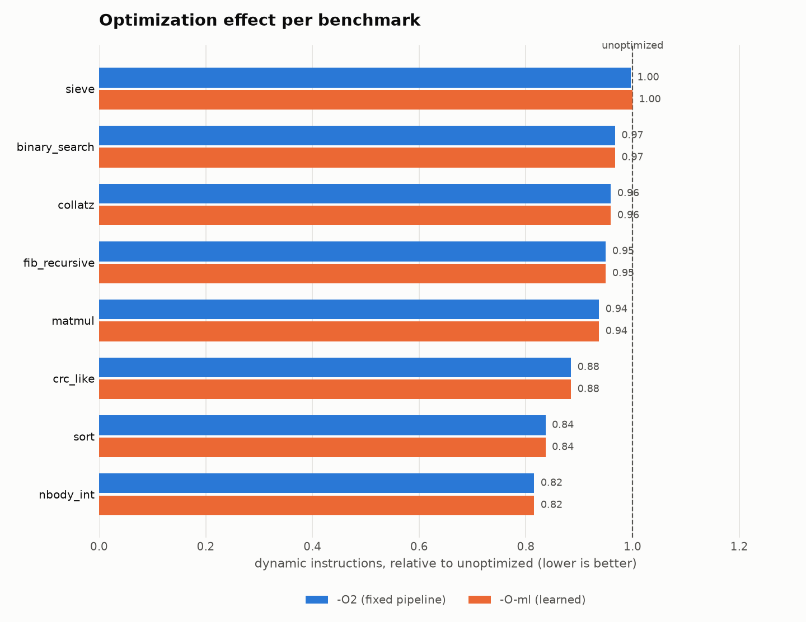
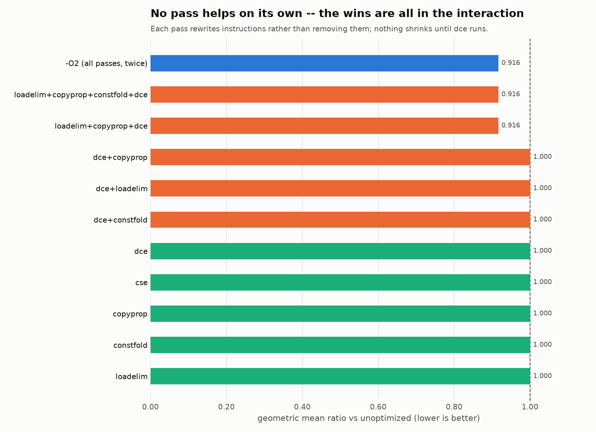

# MLOpt-C

An optimizing compiler for **ToyC**, a small C-like language, written in C++20 —
with a reference interpreter, a three-address IR and optimizer, two backends,
a differential-testing harness, and an ML-guided optimization pass scheduler.

The point of the project is **verification**. Every optimization is checked for
semantic equivalence against a reference interpreter, on hand-written tests and
on thousands of randomly generated programs.

---

## Build and run

```bash
cmake --preset release
cmake --build --preset release
ctest --test-dir build/release --output-on-failure
```

On Windows, run `. ./env.ps1` first — clang there needs the MSVC standard
library and Windows SDK underneath it, and that script puts them on PATH.

```bash
# Run on the reference interpreter
./build/release/bin/mloptc --run-ast bench/programs/sieve.tc

# Run on the IR VM, optimized, with statistics
./build/release/bin/mloptc --run-vm -O2 --stats bench/programs/sieve.tc

# Compile to a native binary through LLVM
./build/release/bin/mloptc --emit-llvm -O2 bench/programs/sieve.tc -o out.ll
clang -O2 out.ll runtime/mloptc_runtime.c -o sieve && ./sieve

# Check that all three paths agree, on 1000 random programs
python verify/differential.py --count 1000 --jobs 8
```

`--list-passes` shows every pass; `--passes a,b,c` runs an exact sequence.

---

## What's here

```
source.tc ──► lexer ──► parser ──► semantic analysis
                                        │
                   ┌────────────────────┴────────────────────┐
                   │                                         │
           AST interpreter                        three-address IR + CFG
           ▸ the reference oracle                            │
                                              ┌──────────────┴──────────────┐
                                              │  IR verifier (after each    │
                                              │  pass, in debug builds)     │
                                              │  5 optimization passes      │
                                              └──────────────┬──────────────┘
                                                             │
                                    ┌────────────────────────┴──────────┐
                                    │                                   │
                              IR virtual machine              LLVM IR text + clang
                              ▸ counts instructions            ▸ native binary
```

Full tour in [`docs/architecture.md`](docs/architecture.md). Design decisions
and the reasoning behind them in [`docs/DESIGN.md`](docs/DESIGN.md).

---

## The decision the whole project rests on

**ToyC is specified to have no undefined behaviour**
([`docs/spec.md`](docs/spec.md) §7). Overflow wraps, division by zero traps,
arrays are bounds-checked, uninitialised variables are zero, argument
evaluation order is fixed.

That is not language-design fussiness. If ToyC had UB, a randomly generated
program could trigger it and the three backends could *legitimately* disagree —
every such case a false alarm needing manual triage, and a fuzzing campaign
would drown in them.

With UB defined away, **any disagreement is a real bug**. That is what makes
unattended fuzzing possible, and it is why programs that trap are a deliberate
part of the test distribution rather than something to filter out.

---

## Verification results

| Check | Result |
|---|---|
| C++ unit tests | **192 passing** |
| All 120 pass orderings × 35 corpus programs, vs the oracle | **0 mismatches** |
| Random programs × 4 execution paths | **480 comparisons, 0 mismatches** |
| (program, pass-sequence) pairs measured during dataset generation | **28,260 behaviour checks, 0 failures** |
| Build | `-Wall -Wextra -Wconversion -Werror`, clean |
| Sanitizers | ASan clean; UBSan on Linux CI |

The IR verifier runs after **every pass** in debug builds, so a pass that
corrupts the IR is named on the spot rather than blamed on the next one.

### Bugs found, and by what

Each was found by a *different* tool, which is the argument for having more than
one.

| Bug | Found by |
|---|---|
| Passing an array to a function was rejected | unit test |
| Call-depth limit unreachable — the interpreter crashed before the counter could fire | unit test (as a crash) |
| Without `loadelim`, `-O2` improved only 7 of 35 corpus programs | effectiveness test |
| Pipeline not idempotent: `cse` ran before `copyprop` | idempotence test |
| **Native exit status wrong on Windows** | **fuzzer, seed 1** |
| **Step-limit aborts shared exit status 70 with real traps** | **fuzzer, seed 5** |
| `-O-ml` selected the empty pipeline, giving zero optimization | benchmark comparison |

The two fuzzer finds are the ones that justify the verification layer. Neither
was reachable from any hand-written test.

**The Windows exit-status bug is the most interesting.** The spec defines the
exit status as `main`'s return value mod 256. The oracle and VM computed that
themselves; the LLVM backend left it to the OS. POSIX truncates an exit code to
8 bits, so it works on Linux — but Windows returns the full 32-bit value, so
`return -2147483648` exited with `-2147483648` natively while the other two
paths reported `0`. A platform-dependent miscompilation that Linux-only CI
would never have caught.

When the fuzzer finds something, `verify/reducer.py` shrinks it. On the seed-5
finding it cut a 20-line program to 11 lines in 40 interestingness tests,
isolating exactly the statement responsible.

---

## Optimization results

Cost metric is **dynamic instruction count** from the IR VM — exactly
reproducible and machine-independent, which wall-clock time on a laptop is not.
It is a *proxy*, not a measurement: it counts a division the same as an add and
ignores cache behaviour entirely.



| benchmark | unoptimized | -O2 | ratio | -O-ml | ratio |
|---|---:|---:|---:|---:|---:|
| binary_search | 24,500,222 | 23,700,122 | 0.967 | 23,700,122 | 0.967 |
| collatz | 5,380,866 | 5,162,852 | 0.959 | 5,162,852 | 0.959 |
| crc_like | 359,788 | 318,316 | 0.885 | 318,316 | 0.885 |
| fib_recursive | 1,500,491 | 1,425,467 | 0.950 | 1,425,467 | 0.950 |
| matmul | 62,028 | 58,138 | 0.937 | 58,138 | 0.937 |
| nbody_int | 2,079,443 | 1,696,259 | 0.816 | 1,696,259 | 0.816 |
| sieve | 94,311 | 94,008 | 0.997 | 94,311 | 1.000 |
| sort | 1,524,762 | 1,276,031 | 0.837 | 1,276,031 | 0.837 |

**Geometric mean: `-O2` 0.9164, `-O-ml` 0.9168** — 8.4% and 8.3% fewer dynamic
instructions. `-O-ml` matches `-O2` exactly on 7 of 8 benchmarks, using a
quarter of the passes.

Modest, and the reason is in the limitations: there is no inlining (so
`fib_recursive` is dominated by call overhead no pass can touch) and no loop
optimizations (so `sieve`, which is almost entirely a strided inner loop, barely
moves).

### The most interesting chart in the project



**No single pass improves anything on its own — and neither does any pair.**

| Passes run | Geometric mean ratio |
|---|---:|
| any one of the five, alone | **1.000** — nothing |
| `dce` + `constfold` | 1.000 |
| `dce` + `loadelim` | 1.000 |
| `dce` + `copyprop` | 1.000 |
| `loadelim` + `copyprop` + `dce` | **0.916** |
| `-O2` (all five, twice — 12 passes) | **0.916** |

The mechanism: each pass *rewrites* instructions rather than removing them.
`loadelim` turns a redundant load into a move, `cse` turns a redundant
computation into a move, `copyprop` rewrites operands. Nothing shrinks until
`dce` runs — and `dce` alone has nothing to remove, because nothing is dead
until the others have run.

It takes all three of `loadelim → copyprop → dce` before anything happens at
all: `loadelim` creates the moves, `copyprop` forwards them so the originals
become unused, and only then does `dce` have something to delete.

**Those three passes achieve exactly what all twelve do.** The entire benefit
lives in pass interaction, and the fixed pipeline is doing four times more work
than necessary — which is the finding the ML layer below acts on.

---

## ML-guided pass selection

`-O-ml` extracts 22 static IR features, scores every candidate pass sequence
with a gradient-boosted forest, and picks one. **Inference runs in C++** — the
model is a JSON file and the compiler has no Python dependency at compile time.

### The honest result

**Pass ordering has no headroom for runtime quality in this compiler.** Across
942 measured programs, *no* candidate sequence beat the fixed `-O2` pipeline on
a single one. Runtime quality is saturated: with five passes that each iterate
to a fixed point, every reasonable sequence converges to the same optimized
code.

That is a real finding, and it is the opposite of the result the project set out
to get. It would have been easy to hide by reporting R² instead.

So the objective was changed to the one that *does* have headroom — **compile
cost**:

| | `-O2` | `-O-ml` |
|---|---:|---:|
| Passes run | 12 | **4.03** |
| Held-out programs matching `-O2` quality | — | **215 / 236** |
| Mean runtime cost vs `-O2` | 1.000 | 1.002 |
| Benchmark geometric mean | 0.9164 | 0.9168 |

`-O-ml` reaches essentially the same code quality while running **66% fewer
passes**. The operating point is chosen on training data against a stated
0.5% quality budget, never on the test set.

**Distribution shift, and fixing it.** The first model trained only on small
random programs and generalised badly to the hand-written benchmarks, which are
larger and far more loop-heavy. On `binary_search` and `fib_recursive` it
dropped `loadelim` and delivered *zero* improvement, giving a benchmark
geometric mean of 0.9262 against `-O2`'s 0.9164.

The fix was to widen the training distribution rather than to special-case the
benchmarks: a second dataset of larger, deeper programs was generated and merged
(`ml/merge_datasets.py`), taking the training set from 537 to 942 programs. The
retrained model now matches `-O2` exactly on 7 of 8 benchmarks.

### What a reader should take from this

The ML component does not beat a well-chosen fixed pipeline on code quality,
and on this compiler nothing could — that ceiling is a property of the pass set,
not of the model. What it does deliver is the same quality for a third of the
compile work, on a question the benchmark data showed was actually open.

The transferable part is the measurement discipline: a reproducible cost model,
a static feature extractor, a train/test split by program (not by row, which
would let the model memorise), an operating point chosen against an explicit
budget on training data, a diagnosed case of distribution shift fixed by
widening the training set, and an evaluation that reports the best *achievable*
result next to the model's so the remaining gap is visible rather than implied.

---

## Reproducing everything

```bash
# 1. Build
cmake --preset release && cmake --build --preset release

# 2. Verify (fast)
ctest --test-dir build/release --output-on-failure
pytest verify/

# 3. Fuzz
python verify/differential.py --count 1000 --jobs 8

# 4. Benchmarks and charts
python bench/run_benchmarks.py
python bench/make_charts.py

# Verify the three-pass claim yourself
./build/release/bin/mloptc --run-vm --stats --passes loadelim,copyprop,dce bench/programs/sort.tc
./build/release/bin/mloptc --run-vm --stats -O2 bench/programs/sort.tc

# 5. Train a model from scratch  (~10 minutes)
pip install -r ml/requirements.txt
python ml/dataset.py --programs 900 --sequences 30 --jobs 6 --out ml/data/dataset_medium.json
python ml/dataset.py --programs 700 --sequences 30 --size large --seed 500000 --jobs 6 --out ml/data/dataset_large.json
python ml/merge_datasets.py ml/data/dataset_medium.json ml/data/dataset_large.json --out ml/data/dataset.json
python ml/train.py
```

---

## Limitations

Stated plainly, because a reader will find them anyway:

- **No SSA form**, so no mem2reg, no global CSE, no LICM. `loadelim` recovers
  much of what mem2reg would give, but only within a basic block — a value
  stored before a loop is reloaded inside it.
- **No inlining and no loop optimizations.** This is where nearly all the
  remaining headroom on the benchmark suite is.
- **Bounds checks are never eliminated**, even when provably redundant.
- **Single file only** — no separate compilation or linking.
- **The ML model does not beat `-O2` on runtime cost**, and nothing in the
  candidate set does. See above.
- **The native backend caps live arrays at 65,536**; the interpreter and VM do
  not.
- **CI has never run.** The workflow in `.github/workflows/ci.yml` is written
  but there is no remote yet; every number here comes from local runs on
  Windows with clang 23.1.3.

---

## Documentation

- [`docs/spec.md`](docs/spec.md) — the ToyC language specification
- [`docs/architecture.md`](docs/architecture.md) — a tour of the codebase
- [`docs/DESIGN.md`](docs/DESIGN.md) — design decisions, including the wrong ones
- [`docs/PROGRESS.md`](docs/PROGRESS.md) — development log

## License

MIT
